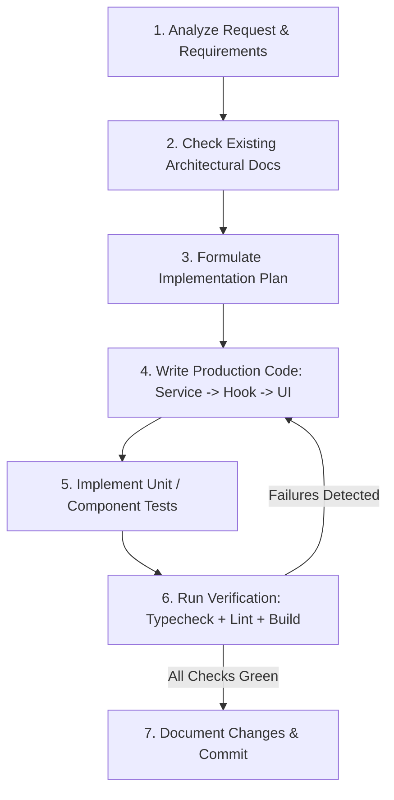

# AGENTS.md — AI Agent Operating Manual & Architecture Guardrails

> **Target Audience:** Autonomous Agents, AI Coding Assistants (Antigravity, Copilot, Claude Code, Cursor), and Human Collaborators.  
> **Status:** Active & Strictly Enforced  
> **Enforcement Level:** Zero Tolerance for Architectural Drift, Untyped Constructs, or Unverified Code.

---

## 1. Executive Summary & Mission

This repository contains the production portfolio and technical showcase for a Senior Frontend Architect and Systems Engineer whose background bridges:
1. **High-Scale Modern Web Applications:** React 19, TypeScript (Strict), Tailwind CSS, Vite.
2. **Full-Stack & Systems Architecture:** PHP (REST APIs, architectural design, enterprise backend systems like **EduScheduler**).
3. **High-Performance Embedded & 10-Foot UI:** **Smart TV development** using **LightningJS** (WebGL/Canvas 2D render trees, 60fps hard frame budgets, D-pad remote spatial navigation, strict memory and garbage collection constraints).

As an AI agent operating in this codebase, you are **not** an auto-complete script. You act as a **Staff Software Engineer**. Every line of code, documentation, and configuration you generate must reflect elite craft, defensive programming, structural modularity, and comprehensive type safety.

---

## 2. Core Guardrails (Non-Negotiable Rules)

```
+-----------------------------------------------------------------------------------+
|                              THE FIVE COMMANDMENTS                                |
| 1. ZERO `any` — Full strict typing; use generics, branded types, or unknown + Zod.|
| 2. STRICT SEPARATION — UI renders; Hooks encapsulate logic; Services handle data. |
| 3. DEFENSIVE BY DEFAULT — Explicit error states, null guards, and Error Boundaries|
| 4. VERIFY BEFORE COMPLETION — Typecheck, lint, test, and build must exit with 0.  |
| 5. CONVENTIONAL COMMITS — Clean, atomic, standardized commit history.             |
+-----------------------------------------------------------------------------------+
```

### 2.1. Strict TypeScript Types (Zero `any` Policy)
* **Absolute Prohibition of `any`:** Under no circumstances may `any` be introduced. The use of `as any` or `// @ts-ignore` is an immediate review failure.
* **Type Narrowing & `unknown`:** If dealing with untyped or third-party input, use `unknown` accompanied by type guards or schema validation (e.g., Zod).
* **Discriminated Unions for State:** Async state must never use disjointed booleans (e.g., `{ isLoading: boolean, isError: boolean, data: T | null }`). Use discriminated unions:
  ```typescript
  export type AsyncState<T, E = Error> =
    | { status: 'idle'; data: null; error: null }
    | { status: 'loading'; data: null; error: null }
    | { status: 'success'; data: T; error: null }
    | { status: 'error'; data: null; error: E };
  ```
* **Explicit Function Return Types:** All exported functions, hooks, and service methods must declare explicit return types.
* **Immutable by Default:** Use `readonly` arrays and properties where state mutations are forbidden.

### 2.2. Modular Component Architecture
Code MUST adhere to a strict 3-tier modular separation of concerns:

```
[Presentation Layer]      UI Components (*.tsx)      <-- Pure rendering, styles, accessible JSX, zero business logic
        |
[State/Domain Layer]      Custom Hooks (use*.ts)     <-- Reactive state, lifecycles, memoization, event coordinators
        |
[Infrastructure Layer]    Services & Clients (*.ts)  <-- Fetching, transformation, API clients, storage, pure algorithms
```

1. **UI Components (`components/`):**
   - Strictly responsible for presentation and accessibility.
   - May consume props and call hooks; must **never** perform direct `fetch`, `localStorage`, or complex state mutation logic inside JSX or event handler blocks.
   - Max file length: **150 lines**. If larger, decompose into sub-components.
2. **Custom Hooks (`hooks/`):**
   - Encapsulate reactive state, side effects, and orchestration.
   - Expose concise, typed APIs (e.g., `{ data, state, handlers }`).
   - Reusable and testable in isolation using React Testing Library's `renderHook`.
3. **Services & Infrastructure (`services/`, `lib/`, `api/`):**
   - Plain TypeScript classes or pure modules.
   - Must be decoupled from React lifecycles (no `useState`, `useEffect`, etc.).
   - Handle network transport, retry policies, cache invalidation, and data sanitization.

### 2.3. Clean Code & Descriptive Naming
* **Self-Documenting Naming:**
  - Booleans must start with a modal verb (`isAvailable`, `hasConflict`, `shouldAutoScroll`, `canReserve`).
  - Event handlers must use the `handle` prefix (`handleSlotSelection`, `handleKeyNavigation`).
  - Event props must use the `on` prefix (`onSelectSlot`, `onNavigate`).
  - Interfaces for objects: PascalCase without prefix (`UserProfile`, not `IUserProfile`).
* **Single Responsibility Principle (SRP):** Every function and module must do exactly one thing well.
* **No Magic Numbers or Strings:** Extract constants to typed config or enum-like objects (`as const`).

### 2.4. Error Handling & Resilience
* **Automated & Graceful Failure:**
  - Network and async service calls must return typed Result objects or throw well-typed custom application errors (`AppError`, `NetworkError`, `ValidationError`).
  - All critical UI boundaries must be wrapped in React `ErrorBoundary` components with accessible fallback views.
* **User Feedback:** Never fail silently. Every caught error must trigger appropriate user-facing notifications (toast, banner, or inline error message) while logging actionable telemetry.

---

## 3. Technology Domain Knowledge

When generating features, interactive widgets, or case studies, agents must respect the architectural nuances of the user's signature domains:

### 3.1. Core Web Stack (React 19 + TypeScript + Tailwind CSS)
* **Tailwind CSS Rules:**
  - Use semantic color tokens configured via `tailwind.config.ts`.
  - Avoid inline CSS styles unless calculating dynamic canvas/interpolated values.
  - Group utility classes logically: Layout (`flex`, `grid`) -> Spacing (`p-4`, `m-2`) -> Sizing (`w-full`, `h-16`) -> Typography (`text-sm`, `font-semibold`) -> Visuals (`bg-surface`, `rounded-lg`, `shadow-sm`) -> Interactive states (`hover:`, `focus-visible:`).
  - Use `clsx` and `tailwind-merge` (`cn()` helper) for dynamic class composition.
* **React 19 Features:**
  - Leverage modern React compiler-ready practices: minimize redundant `useMemo`/`useCallback` where simple primitives suffice, but maintain strict reference equality for high-frequency renders.
  - Leverage `useTransition`, `useDeferredValue`, and Actions where appropriate for smooth UI updates.

### 3.2. EduScheduler Experience Showcase (PHP / REST + React)
* **Domain Context:** Enterprise classroom and campus resource reservation system.
* **Architectural Hallmarks:**
  - Complex conflict detection algorithms (interval trees, overlapping time slot math).
  - Strict Role-Based Access Control (RBAC): Student, Professor, Department Head, Facility Administrator.
  - Optimistic UI updates with rollbacks on concurrent booking collisions (409 Conflict).
  - Robust backend contracts reflecting clean PHP 8.x architecture (Typed DTOs, Service/Repository patterns, PSR-12 conventions).

### 3.3. Smart TV & Embedded Development Showcase (LightningJS)
* **Domain Context:** 10-foot UI designed for connected TVs, set-top boxes, and OTT platforms.
* **Architectural Hallmarks:**
  - **WebGL/Canvas 2D Rendering Engine:** No DOM rendering; uses a strict render tree node hierarchy (`lng.Component`).
  - **Spatial Focus Management:** D-Pad navigation (Up, Down, Left, Right, Enter, Back). Strict state machine for focus delegation (`_focus`, `_unfocus`, `_handleKey`).
  - **Hard Performance Budgets:** Sustained 60 FPS on low-power ARM CPUs with <512MB RAM constraints.
  - **Memory & Garbage Collection:** Texture recycling, manual cleanup of unmounted surfaces, prevention of closures retaining large video/image payloads.

---

## 4. Pre-Flight Verification Protocol

Before declaring any coding or refactoring task complete, agents **MUST** execute and pass all verification checks locally:

```bash
# 1. Typecheck the entire codebase with zero errors
npm run typecheck   # (tsc --noEmit)

# 2. Lint check with ESLint
npm run lint        # (eslint . --max-warnings 0)

# 3. Unit & Integration test suite
npm run test        # (vitest run)

# 4. Production build verification
npm run build       # (vite build)
```

> **Mandate:** If any step fails, the agent must diagnose the root cause, fix the issue cleanly, and re-run the verification pipeline until all tests and checks pass. Never bypass checks with `--no-verify` or relaxed rules.

---

## 5. Git Commit & PR Standards

All commits produced by agents must strictly follow the **Conventional Commits** specification:

### 5.1. Commit Format
```
<type>(<scope>): <short imperative summary>

[optional body explaining motivation, architectural trade-offs, and details]

[optional footer(s), e.g., Closes #123]
```

### 5.2. Allowed Types
| Type | Description |
| :--- | :--- |
| `feat` | New user-facing feature or showcase component |
| `fix` | Bug fix or visual glitch correction |
| `refactor` | Code change that neither fixes a bug nor adds a feature |
| `docs` | Documentation changes only |
| `style` | Formatting, whitespace, or missing semicolon updates (no logic change) |
| `test` | Adding missing tests or correcting existing tests |
| `perf` | Performance improvement (e.g., render loop optimization) |
| `chore` | Build process, tooling, dependencies, or config changes |

### 5.3. Examples
- `feat(eduscheduler): implement interval conflict matrix for multi-room booking`
- `perf(smart-tv): optimize texture pool lifecycle to eliminate memory leak on route transition`
- `refactor(ui): extract useSpatialNavigation hook from TVShowcaseContainer`
- `fix(theme): resolve contrast ratio issue on dark mode button focus states`

---

## 6. Agent Step-by-Step Execution Workflow

When tasked with a feature or bugfix, the agent must adhere to this structured flow:



1. **Analyze Requirements:** Understand requirements, edge cases, and accessibility considerations.
2. **Consult Docs:** Review `docs/architecture/`, `docs/system/conventions.md`, and relevant ADRs.
3. **Formulate Plan:** Outline necessary changes, files to create or modify, and tests to write.
4. **Implement Cleanly:** Write types first, then services, hooks, and finally presentation components.
5. **Add Tests:** Verify logic with unit tests for edge cases, error conditions, and user flows.
6. **Verify:** Run the full verification suite (`typecheck`, `lint`, `test`, `build`).
7. **Commit & Summarize:** Create conventional commit and provide a clear, technical summary of changes made.
