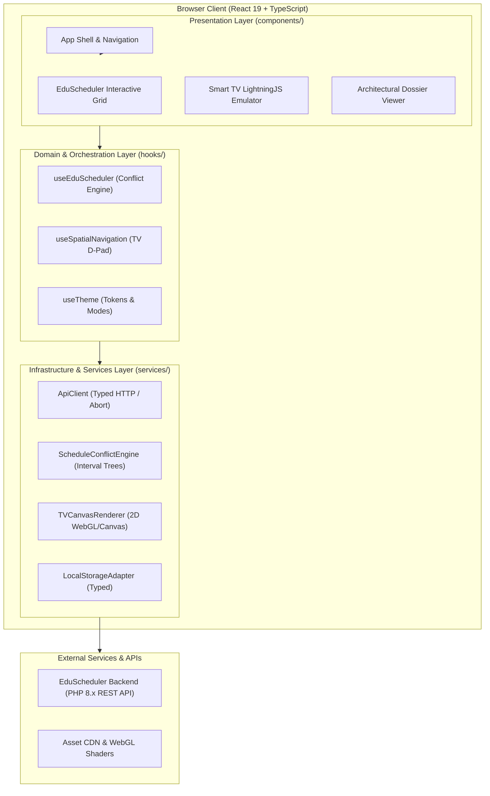

# System Architecture Overview

> **Document ID:** DOC-ARCH-001  
> **Status:** Approved  
> **Role:** Master System Architecture Blueprint

---

## 1. Architectural Mission & Philosophy

The architecture of this portfolio is designed to solve a dual challenge:
1. Present a sleek, accessible, responsive portfolio experience for engineering leaders, hiring teams, and technical collaborators.
2. Serve as a live, production-grade technical showcase that directly demonstrates the author's core expertise:
   - Modern React & TypeScript scalable architecture.
   - Enterprise backend integration (PHP REST APIs / EduScheduler).
   - Constrained embedded systems & 10-foot UI architecture (Smart TV / LightningJS).

Rather than relying on static mockups or screenshots, the architecture incorporates **interactive micro-applications** and **emulation layers** embedded directly into the frontend.

---

## 2. High-Level System Topology

---

## 3. Layered Architectural Boundaries

The application is strictly partitioned into three decoupled horizontal layers:

### 3.1. Presentation Layer (`src/components/`)
* **Role:** Pure projection of state into accessible HTML/DOM or Canvas surfaces.
* **Characteristics:**
  - Zero side-effects or direct external network calls.
  - Composable, isolated, styled strictly via Tailwind CSS utility tokens.
  - Strict typing via explicit props interfaces.
  - Keyboard accessible (ARIA compliant, tab navigation, screen reader friendly).

### 3.2. Domain / Orchestration Layer (`src/hooks/` & `src/context/`)
* **Role:** Encapsulates business logic, reactive state transitions, lifecycle hooks, and interaction coordination.
* **Characteristics:**
  - Manages asynchronous status flows (idle, loading, success, error) via discriminated unions.
  - Binds UI actions to domain operations.
  - Keeps presentation components clean and declarative.

### 3.3. Infrastructure Layer (`src/services/` & `src/utils/`)
* **Role:** Pure TypeScript logic handling network transport, computational algorithms, hardware interfaces, and storage.
* **Characteristics:**
  - **Zero React dependencies:** Can be tested in standalone Node/Vitest environments.
  - Encapsulates scheduling interval trees for clash detection.
  - Encapsulates WebGL/Canvas render loops and texture pools for the Smart TV engine.
  - Implements defensive error handling and network resilience.

---

## 4. Key Architectural Subsystems

### 4.1. EduScheduler Interactive Module
* **Backend Origin:** Built originally with PHP 8.x, PSR-12 compliant, with typed REST endpoints and MySQL storage.
* **In-Portfolio Implementation:**
  - Client-side interval tree conflict detection engine simulating backend validation logic.
  - Optional live demo mode connecting to a real PHP backend or executing against high-fidelity mock service workers.
  - Demonstrates optimistic concurrency: Reservations update immediately in the UI; if a conflict or server 409 occurs, the state rolls back with an accessible warning toast.

### 4.2. Smart TV LightningJS Interactive Sandbox
* **Embedded Challenge:** Connected TV devices (Samsung Tizen, LG webOS, Comcast X1) possess limited CPU and memory; the DOM is too slow for 60fps animations.
* **In-Portfolio Implementation:**
  - Renders a dedicated `<canvas>` element driven by LightningJS rendering paradigms (or an optimized Canvas2D/WebGL tree).
  - Emulates 10-foot UI spatial navigation: arrow keys simulate the remote control D-Pad.
  - Focus state machine: Nodes manage focus transitions deterministically, recycling textures and keeping draw calls within strict budgets.

---

## 5. Security & Performance Baseline

* **Zero `any` Typing:** Maximum compiler strictness eliminates entire classes of runtime exceptions.
* **Content Security Policy (CSP):** Strict nonce-based scripts and restricted connect-src directives.
* **Bundle Budget:** Core bundle kept under **120 KB gzipped** using route-level code splitting (`React.lazy`) and modern tree-shaking via Vite.
* **Frame Budget:** 60 FPS (16.6ms per frame) maintained across interactive calendar drag operations and TV canvas transitions.
