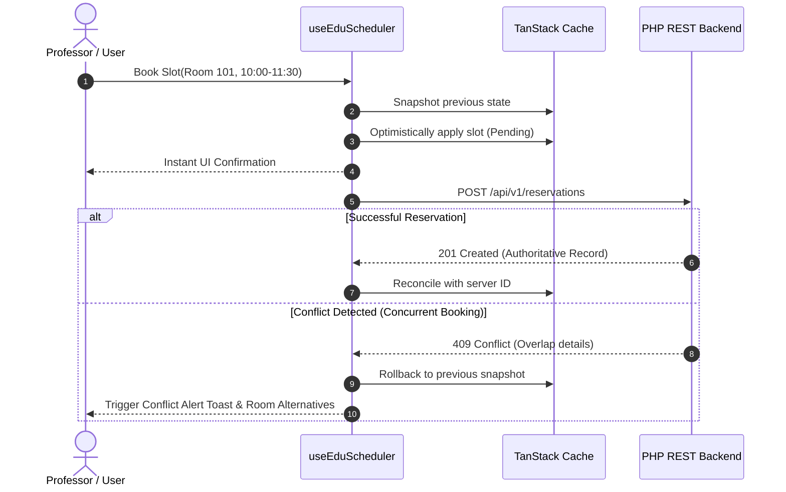

# State Management Architecture

> **Document ID:** DOC-ARCH-003  
> **Status:** Approved  
> **Role:** State Stratification, Caching, and Optimistic Sync Architecture

---

## 1. State Stratification Model

To prevent bloated state objects and state sync bugs, state is divided into four distinct categories:

```
┌────────────────────────────────────────────────────────────────────────┐
│ 1. Server State (Asynchronous Data & Caching)                          │
│    - Handled by: TanStack Query / Typed Query Hooks                    │
│    - Examples: Classroom bookings, user profiles, remote project data   │
├────────────────────────────────────────────────────────────────────────┤
│ 2. Global Client State (Application UI & Machine State)               │
│    - Handled by: Zustand (Lightweight, outside-React store access)     │
│    - Examples: Active theme, TV emulator state, active modal ID        │
├────────────────────────────────────────────────────────────────────────┤
│ 3. URL / Navigation State (Shareable Deep Links)                       │
│    - Handled by: URLSearchParams & React Router                        │
│    - Examples: Selected date filter, active project tab, search query  │
├────────────────────────────────────────────────────────────────────────┤
│ 4. Local Component State (Ephemeral UI State)                          │
│    - Handled by: React useState / useReducer                           │
│    - Examples: Form draft inputs, hover tooltips, accordion expansion  │
└────────────────────────────────────────────────────────────────────────┘
```

---

## 2. Server State & Optimistic Synchronization

### 2.1. The Conflict Problem (EduScheduler Domain)
In classroom scheduling, multiple professors or department coordinators may attempt to book the same room for the same time slot concurrently.
A naive UI waits for the roundtrip network request, causing sluggish UX. An untyped optimistic UI can lead to desynchronization and corrupted client state.

### 2.2. Optimistic Mutation with Rollback Protocol
1. **Snapshot Current State:** Record previous query cache data before mutation.
2. **Apply Optimistic Delta:** Immediately update the local cache to display the reservation as confirmed.
3. **Dispatch Network Request:** Send the booking request to the backend service.
4. **On HTTP 200 (Success):** Commit the server's authoritative record and revalidate affected intervals.
5. **On HTTP 409 (Conflict Error):** Roll back the cache to the saved snapshot, flash an alert dialog showing the overlapping reservation, and highlight alternative available rooms.



---

## 3. Global Client State with Zustand

Zustand is chosen for application-wide UI state because:
- Zero boilerplate (no reducers, action creators, or context wrappers).
- Decoupled from React lifecycle (accessible inside callbacks and services outside the render loop).
- Minimal bundle impact (< 1.2 KB).

### 3.1. TV Emulator Machine State
The Smart TV emulator manages its internal hardware emulation state (D-Pad focus node, volume, power state, resolution simulation) via a dedicated Zustand store:

```typescript
import { create } from 'zustand';

export interface TVEmulatorState {
  readonly isPoweredOn: boolean;
  readonly activeFocusId: string;
  readonly activeRoute: string;
  readonly simulatedFPS: number;
  readonly memoryUsageMB: number;
  readonly setPoweredOn: (power: boolean) => void;
  readonly setFocusId: (id: string) => void;
  readonly navigateRoute: (route: string) => void;
  readonly updateMetrics: (fps: number, memoryMB: number) => void;
}

export const useTVEmulatorStore = create<TVEmulatorState>((set) => ({
  isPoweredOn: true,
  activeFocusId: 'hero-banner',
  activeRoute: '/home',
  simulatedFPS: 60,
  memoryUsageMB: 42.5,
  setPoweredOn: (power) => set({ isPoweredOn: power }),
  setFocusId: (id) => set({ activeFocusId: id }),
  navigateRoute: (route) => set({ activeRoute: route }),
  updateMetrics: (fps, memoryMB) => set({ simulatedFPS: fps, memoryUsageMB: memoryMB }),
}));
```

---

## 4. State Immutability & Persistence

* All store state updates must be immutable. Never mutate state directly in-place.
* State requiring persistence (e.g., user theme preference or dismissed banners) is synced to `localStorage` via a strongly typed adapter with versioned schemas, ensuring backwards compatibility across releases.
