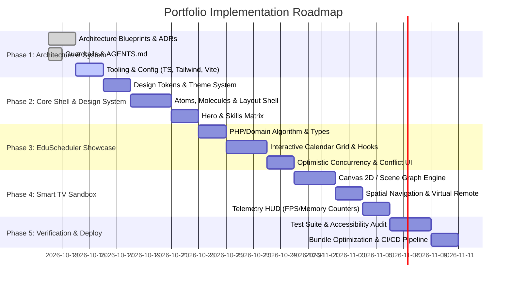

# Project Engineering Roadmap

> **Document ID:** DOC-PLAN-001  
> **Status:** Active  
> **Role:** Phased Implementation Milestones & Work Breakdown Structure

---

## 1. Roadmap Overview

The engineering lifecycle of the portfolio is divided into five sequential phases, balancing foundational architecture, interactive showcases, performance optimization, and production deployment.

---

## 2. Phase Breakdown

### Phase 1: Architecture & Foundation (Completed / In Progress)
* [x] Establish architecture documentation suite (`docs/architecture/`, `docs/decisions/`, `docs/product/`, `docs/system/`).
* [x] Formulate strict AI agent operating rules (`AGENTS.md`) and coding conventions (`conventions.md`).
* [ ] Initialize project configuration files (`package.json`, `tsconfig.json`, `tailwind.config.ts`, `vite.config.ts`).
* [ ] Configure ESLint, Prettier, and Vitest test harness.

### Phase 2: Core Shell & Design Tokens
* [ ] Implement semantic color tokens, typography, and dark/light theme switching.
* [ ] Build primitive components (`Button`, `Card`, `Badge`, `Modal`, `Input`) adhering to WCAG 2.1 AA.
* [ ] Construct top-level responsive layout shell (`Navbar`, `Footer`, `SectionShell`).
* [ ] Implement Hero section and interactive technical competence matrix (React, TypeScript, Tailwind, PHP, LightningJS).

### Phase 3: EduScheduler Interactive Showcase
* [ ] Define TypeScript domain contracts and interfaces (`Room`, `Reservation`, `TimeInterval`, `ConflictResult`).
* [ ] Implement client-side interval tree collision engine in `src/services/eduscheduler/conflictEngine.ts`.
* [ ] Build `useEduScheduler` hook managing optimistic reservations and rollback states.
* [ ] Construct interactive day/week calendar grid component with time-slot drag selection.
* [ ] Add technical architecture modal displaying the PHP backend design and SQL transaction locks.

### Phase 4: Smart TV LightningJS Interactive Sandbox
* [ ] Build lightweight TypeScript 2D canvas scene graph engine in `src/services/tv-emulator/`.
* [ ] Implement D-Pad spatial navigation state machine supporting `ArrowUp/Down/Left/Right`, `Enter`, and `Back`.
* [ ] Develop on-screen SVG TV Remote Control with clickable buttons and active tactile states.
* [ ] Implement memory-safe texture recycling and 60 FPS animation loop.
* [ ] Add real-time telemetry HUD displaying active node ID, FPS, draw calls, and memory usage.

### Phase 5: Production Hardening, Quality Assurance & Deployment
* [ ] Execute 100% strict TypeScript check (`npm run typecheck`).
* [ ] Run comprehensive Vitest unit and integration test suite (`npm run test`).
* [ ] Perform Lighthouse audit targeting 98+ scores across all categories.
* [ ] Implement automated GitHub Actions CI/CD pipeline (`.github/workflows/ci.yml`).
* [ ] Deploy production build to global edge CDN with immutable asset caching.
