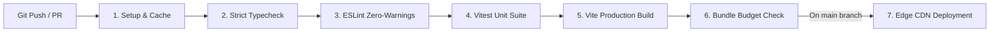

# CI/CD Pipeline & Deployment Architecture

> **Document ID:** DOC-SYS-004  
> **Status:** Active  
> **Role:** Continuous Integration, Quality Automation & Deployment Blueprint

---

## 1. Overview & Pipeline Philosophy

The Continuous Integration and Continuous Deployment (CI/CD) architecture enforces an automated quality gate for every commit and pull request. Code cannot reach the `main` branch without passing static analysis, strict type checking, unit test suites, and bundle size constraints.



---

## 2. GitHub Actions Workflow Specification

The automated pipeline is defined in `.github/workflows/ci.yml`:

```yaml
name: CI / Production Quality Gate

on:
  push:
    branches: [main]
  pull_request:
    branches: [main]

concurrency:
  group: ${{ github.workflow }}-${{ github.ref }}
  cancel-in-progress: true

jobs:
  verify:
    name: Verify & Test
    runs-on: ubuntu-latest
    timeout-minutes: 10

    steps:
      - name: Checkout Codebase
        uses: actions/checkout@v4

      - name: Setup Node.js 20 LTS
        uses: actions/setup-node@v4
        with:
          node-version: 20
          cache: 'npm'

      - name: Install Dependencies
        run: npm ci

      - name: Strict TypeScript Verification
        run: npm run typecheck

      - name: ESLint (Zero Warnings Permitted)
        run: npm run lint

      - name: Execute Vitest Test Suites
        run: npm run test

      - name: Build Production Assets
        run: npm run build

      - name: Enforce Bundle Budget (< 120 KB gzip)
        run: |
          MAX_SIZE_KB=120
          BUNDLE_SIZE=$(gzip -c dist/assets/index-*.js | wc -c)
          BUNDLE_SIZE_KB=$((BUNDLE_SIZE / 1024))
          echo "Main bundle gzip size: ${BUNDLE_SIZE_KB} KB"
          if [ $BUNDLE_SIZE_KB -gt $MAX_SIZE_KB ]; then
            echo "Error: Bundle size exceeds ${MAX_SIZE_KB} KB budget!"
            exit 1
          fi

  deploy:
    name: Deploy to Edge CDN
    needs: verify
    if: github.ref == 'refs/heads/main' && github.event_name == 'push'
    runs-on: ubuntu-latest

    steps:
      - name: Checkout Codebase
        uses: actions/checkout@v4

      - name: Setup Node.js 20 LTS
        uses: actions/setup-node@v4
        with:
          node-version: 20
          cache: 'npm'

      - name: Install Dependencies & Build
        run: |
          npm ci
          npm run build

      - name: Deploy Production Distribution
        run: echo "Deploying static assets in dist/ to CDN Edge..."
```

---

## 3. Branch Protection & Git Hygiene

The `main` branch is protected by repository rules:
* **Require Pull Request Reviews:** Direct pushes to `main` are disabled.
* **Require Status Checks to Pass:** All jobs in `CI / Production Quality Gate` must pass.
* **Require Linear History:** Merges must be squash-merged or rebased to preserve a clean Conventional Commits history.
* **Automated Conventional Commit Linting:** Commit messages must conform to `commitlint` standards.
